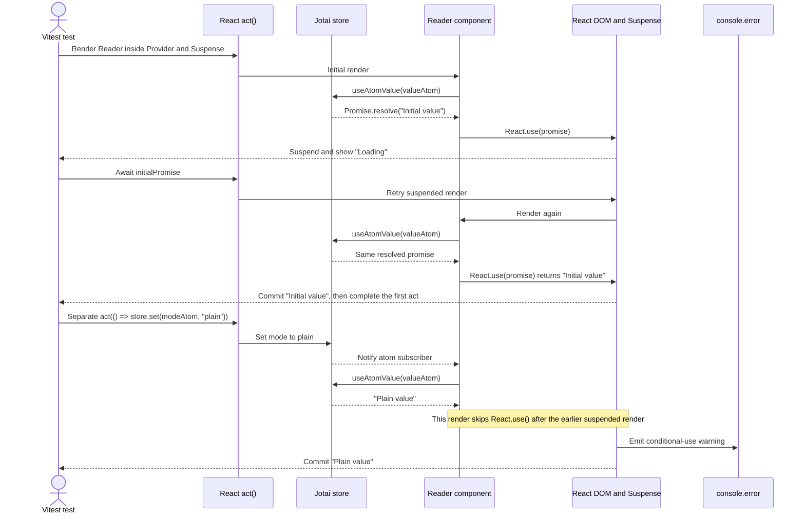

# Jotai async atom / React 19.3 repro

A minimal Vitest + JSX component test reproducing React 19.3's development
warning when Jotai `useAtomValue` suspends on a promise and later reads a plain
value.

## Related issue

Related discussion: [pmndrs/jotai#3381](https://github.com/pmndrs/jotai/discussions/3381)

## Run

```sh
pnpm install
pnpm test
```

The test mounts a component reading an async atom under `Suspense`. After the
promise resolves and the initial value commits, it updates the same atom to a
plain value in a separate `act()` call.

React emits this exact message through `console.error` during the plain-value
update:

```text
This library called use() to suspend in a previous render but did not call use() when it finished. This indicates an incorrect use of use(). Learn more: https://react.dev/warnings/conditional-use-of-use
```

## Timing



## Versions

- React / React DOM: `19.3.0`
- Jotai: `3.0.1`
- Vitest: `5.0.5`
- React Testing Library: `16.3.3`
- jsdom: `30.1.3`
- `pnpm-lock.yaml` locks the dependency tree.
